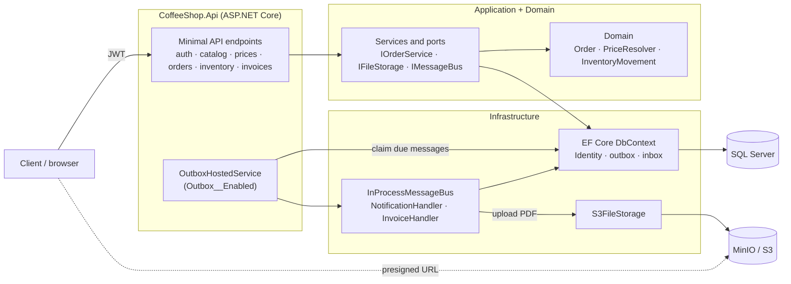
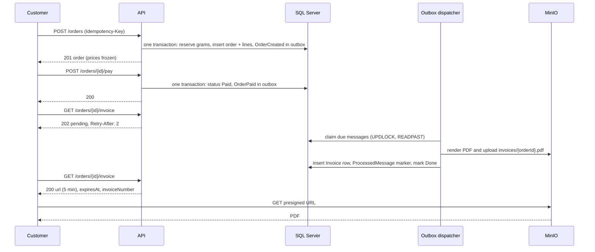
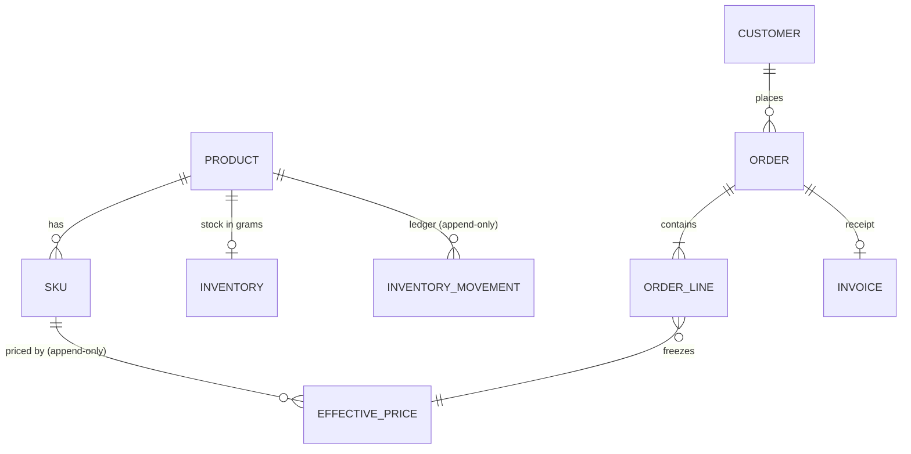

# CoffeeShop

Backend for a specialty coffee shop: a catalogue with time-based pricing, customer orders with gram-based stock reservation, a transactional outbox, and PDF invoices stored in S3-compatible storage. It is the baseline for a .NET + Angular application; the Angular front end (`/web`) has its foundation (design system, auth, sign-in pages) the customer flow (catalogue, cart, checkout, orders, invoices) and the admin screens (prices, inventory).

## Status

| Milestone | Scope | State |
|---|---|---|
| 1 | Solution, domain, effective prices, `GET /products`, `GET /skus/{id}/price` | Done |
| 2a | ASP.NET Core Identity, JWT login, Admin and Customer roles | Done |
| 2b | Admin price management (append-only prices) | Done |
| 3a | Orders, gram-based inventory, pay and cancel | Done |
| 3b | Transactional outbox with an in-process dispatcher | Done |
| 3c | Admin inventory, concurrency guarantees | Done |
| 4a | S3 file storage (MinIO), PDF invoices for paid orders | Done |
| 4b | Invoice download with presigned URLs; MXN as store currency | Done |
| 5a | Angular foundation: "Roastery" Material 3 design system, generated API client, auth, app shell, sign-in and register | Done |
| 5b | Customer flow: catalogue with live prices, cart, idempotent checkout, orders, order detail with pay/cancel and invoice polling | Done |
| 5c | Admin prices and inventory screens, nginx web container, full-stack purchase spec | Done |
| 6a | Demo seeder (Development only) and one-command local environment | Done |
| 6b | Debug configs, dev clock, admin outbox and health endpoints, api.http, correlation-id request logs | Done |

253 backend tests (domain, application, infrastructure and HTTP integration against real SQL Server and MinIO containers), plus 56 web component tests (Vitest in Chromium) and 50 page tests (Playwright, desktop and mobile).

## Tech stack

| Area | Choice |
|---|---|
| Runtime | .NET 10 (LTS), ASP.NET Core minimal APIs |
| Data | EF Core 10, SQL Server 2022 (READ_COMMITTED_SNAPSHOT), LocalDB for development |
| Auth | ASP.NET Core Identity, JWT bearer tokens (HS256, 60 min) |
| Messaging | Transactional outbox, `IMessageBus` with an in-process bus (broker-agnostic, SQS-ready) |
| Storage | `IFileStorage` over AWSSDK.S3; MinIO locally, S3 later |
| Documents | QuestPDF (Community licence) |
| API docs | OpenAPI document (`/openapi.json`) and Swagger UI in Development |
| Tests | xUnit, `WebApplicationFactory`, Testcontainers (SQL Server, MinIO) |
| Front end | Angular 22 (standalone, signals, zoneless), Angular Material 3 + CDK, ng-openapi-gen client |
| Web tests | Vitest browser mode (Chromium) for components, Playwright + axe-core for pages |
| Containers | Docker Compose: `sqlserver`, `minio`, `api` |

## Architecture



### Order, payment and invoice flow



### Domain model



## Key rules

- The current price of a SKU is the row with the greatest `effective_from <= asOf`; prices are insert-only, in the store currency (MXN).
- An order line freezes its unit price; stock is reserved in grams (`size_g × qty`) in the same transaction, never oversold.
- The same `Idempotency-Key` from the same customer returns the original order without side effects.
- Outbox delivery is at-least-once; handlers are idempotent through `ProcessedMessage` and deterministic keys.
- Invoices are demo receipts (not fiscal documents); download links are presigned and expire after 5 minutes.

Full rules live in [CLAUDE.MD](CLAUDE.MD); design decisions and trade-offs in [DECISIONS.md](DECISIONS.md).

## API

| Method | Path | Access |
|---|---|---|
| POST | `/auth/register`, `/auth/login` | Anonymous |
| GET | `/auth/me` | Authenticated |
| GET | `/products`, `/skus/{id}/price?asOf=` | Anonymous |
| POST | `/prices` | Admin |
| GET | `/skus/{id}/prices` | Admin |
| POST | `/orders` (optional `Idempotency-Key`) | Customer |
| GET | `/orders`, `/orders/{id}` | Owner (Admin for `{id}`) |
| POST | `/orders/{id}/pay`, `/orders/{id}/cancel` | Owner |
| GET | `/orders/{id}/invoice` | Owner or Admin |
| GET | `/admin/inventory`, `/admin/inventory/{productId}/movements` | Admin |
| POST | `/admin/inventory/{productId}/restock` | Admin |
| GET | `/admin/outbox?status=Pending\|Done\|Failed&page=&pageSize=` | Admin |
| GET | `/health` (liveness + SQL Server + bucket), `/health/live` | Anonymous |

The full contract, status codes included, is in [openapi.json](openapi.json); Swagger UI is served at `/swagger` in Development.

## Run locally

Prerequisites: .NET 10 SDK, Node.js 24+, Docker Desktop. Infrastructure runs in Docker; API and web run on the host.

```bash
cp .env.example .env    # local-only defaults; change them if you like
scripts/dev.sh          # or scripts/dev.ps1: DB + MinIO, migrations, demo data, API on :5121, web on :4200
scripts/dev-reset.sh    # or scripts/dev-reset.ps1: drop the volumes so the next run reseeds
```

The script prints the URLs and the demo Admin and Customer credentials from `.env`. Every response carries an `X-Correlation-Id`, which also prefixes the API's log lines; `api.http` walks the role boundaries and the order flow.

**VS Code:** F5 on the "Full stack" compound starts the infrastructure, the API under the .NET debugger and Chrome on `ng serve`.
**Visual Studio / Rider:** run `scripts/dev-infra.ps1` (or `.sh`) once, then start the Api `http` launch profile and `npm start` in `web`.
The launch profile does not read `.env`: put the values from the generated `.vscode/api.env` in the Api user-secrets (`:` instead of `__`).

## Getting started

Prerequisites: .NET 10 SDK, Docker Desktop, and SQL Server LocalDB (Windows) for local runs.

### Option A: API on your machine, MinIO in Docker

```bash
cp .env.example .env      # then fill in the passwords and Jwt__Key
docker compose up -d minio
dotnet tool restore
dotnet ef database update -p src/Infrastructure -s src/Api
dotnet user-secrets set "Jwt:Key" "<32+ random characters>" --project src/Api
dotnet user-secrets set "Jwt:Issuer" "coffeeshop" --project src/Api
dotnet user-secrets set "Jwt:Audience" "coffeeshop" --project src/Api
dotnet user-secrets set "Storage:AccessKey" "<MINIO_USER from .env>" --project src/Api
dotnet user-secrets set "Storage:SecretKey" "<MINIO_PASSWORD from .env>" --project src/Api
dotnet run --project src/Api
```

Development defaults point the API at LocalDB and at MinIO on `localhost:9000`. Optionally set `Admin:Email` and `Admin:Password` to seed an Admin user.

### Option B: everything in Docker

```bash
docker compose up -d --build
ConnectionStrings__Default="Server=127.0.0.1,1433;Database=CoffeeShop;User Id=sa;Password=<MSSQL_SA_PASSWORD>;TrustServerCertificate=True" \
  dotnet ef database update -p src/Infrastructure -s src/Api
```

The web app (nginx, proxying `/api`) listens on http://localhost:8080, the API on http://localhost:8081 and the MinIO console on http://localhost:9001. Migrations are not applied at startup; the `api` container restarts until the database and MinIO are ready.

## Configuration

| Setting | Purpose | Default |
|---|---|---|
| `ConnectionStrings__Default` | SQL Server connection | LocalDB in Development |
| `Jwt__Key`, `Jwt__Issuer`, `Jwt__Audience` | Token signing; the app refuses to start without them (key ≥ 32 chars) | — |
| `Admin__Email`, `Admin__Password` | Seed an Admin user at startup when both are set | — |
| `Storage__Endpoint`, `Storage__PublicEndpoint` | Internal S3 endpoint, and the one used to sign browser URLs | `http://localhost:9000` in Development |
| `Storage__Bucket`, `Storage__AccessKey`, `Storage__SecretKey`, `Storage__Region` | Bucket and credentials | `coffeeshop-invoices`, `us-east-1` |
| `Storage__CreateBucketIfMissing` | Create the private bucket at startup | `true` in Development |
| `Outbox__Enabled`, `Outbox__PollIntervalMs`, `Outbox__BatchSize`, `Outbox__MaxAttempts` | Dispatcher loop (disable to host it separately) | `true`, `1000`, `20`, `5` |
| `Pricing__Currency` | Store currency every new price must use | `MXN` |
| `Dev__ClockOffsetDays` | Shifts the app clock by whole days (Development only; startup fails elsewhere). Tokens and presigned URLs keep the real time | — |

## Tests

```bash
dotnet test --nologo -v q
```

Docker must be running: integration tests start one shared SQL Server and one MinIO container. SQL Server tests in `Infrastructure.Tests` use a temporary LocalDB database on Windows.

Web (Node.js 24 or 26, from `/web`):

```bash
npm ci
npm run e2e:install    # Chromium for both test layers, inside node_modules
npm test               # coverage check + Vitest component tests in Chromium
npm run e2e            # Playwright page tests, desktop and mobile, API mocked
npm run e2e:full       # purchase flow against the compose stack; needs E2E_ADMIN_EMAIL/E2E_ADMIN_PASSWORD
npm start              # http://localhost:4200, /api proxied to the API on :5121
```

After an API change, regenerate the client with `npm run gen:api` (and `openapi.json` from the API tests).

## Project structure

```
src/Domain           Entities, PriceResolver, order state machine
src/Application      Use-case services and ports (IFileStorage, IMessageBus, IOrderService)
src/Infrastructure   EF Core, Identity, outbox and bus, S3 storage, invoices, migrations
src/Api              Minimal API endpoints, auth, OpenAPI, Dockerfile
tests/*.Tests        Domain, Application, Infrastructure and Api (integration) tests
web/                 Angular app: src/app (core, layout, shared, pages, generated api), e2e, testing/fixtures
docker-compose.yml   sqlserver, minio, api, web (nginx)
openapi.json         Committed API contract, kept in sync by a test
```

## Next steps

- Login lockout and rate limiting; refresh tokens.
- Retention job for processed outbox messages and inbox markers.
- Retry on deadlocks for every write path (EF execution strategy).
